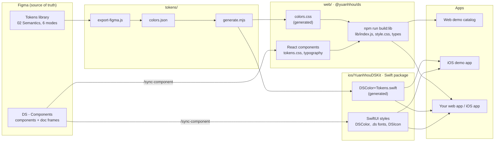
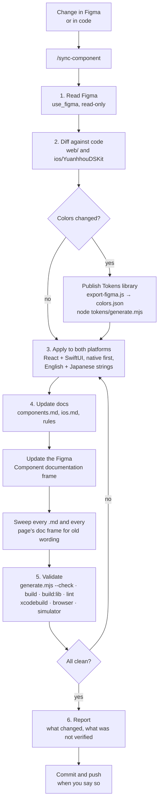

# Workflow

How the design system moves from Figma to the two packages and the apps, and the steps every change follows. The same diagrams are in the Figma file [Ai Design Systems Workflow](https://www.figma.com/design/IJKMYKXRddNKjFwY9yWYAv/Ai-Design-Systems-Workflow?node-id=4-2).

## How the pieces fit

Figma is the source of truth. Colors are exported once and generated for both platforms; components are synced by hand, through Claude, with the `/sync-component` skill.

## Making a change

The same steps whether the change starts in Figma or in code. `/sync-component <Component|tokens> [figma|code]` runs them for React and SwiftUI together.

## Where each step's rules live
| Step | Rules |
|---|---|
| Native first, color pairing, contrast | [design-system-rules.md](../design-system-rules.md) |
| Component specs | [components.md](components.md) |
| SwiftUI usage | [ios.md](ios.md) |
| Token export and generation | [tokens/README.md](../tokens/README.md) |
| The skill itself | [.claude/skills/sync-component/SKILL.md](../.claude/skills/sync-component/SKILL.md) |
