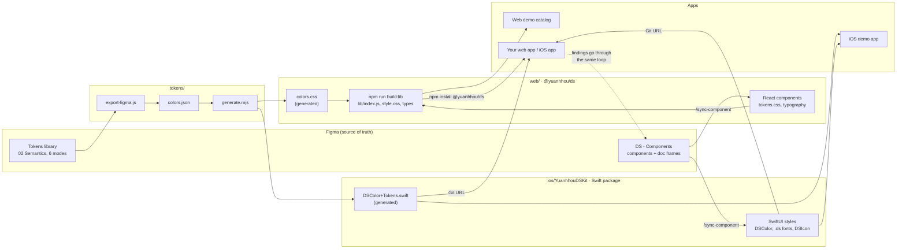
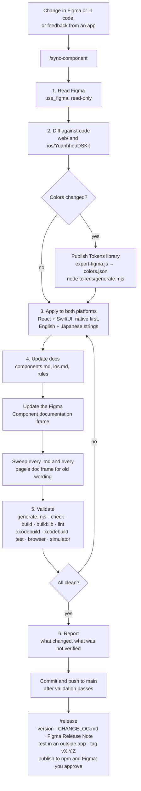
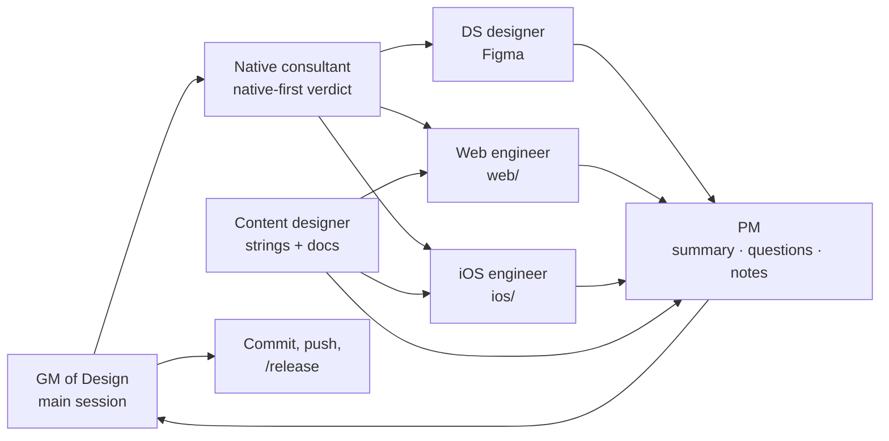

# Workflow

How the design system moves from Figma to the two packages and the apps, and the steps every change follows. The same diagrams are in the Figma file [Ai Design Systems Workflow](https://www.figma.com/design/IJKMYKXRddNKjFwY9yWYAv/Ai-Design-Systems-Workflow?node-id=4-2).

## How the pieces fit

Figma is the source of truth. Colors are exported once and generated for both platforms; components are synced by hand, through Claude, with the `/sync-component` skill.

## Making a change

The same steps whether the change starts in Figma, in code or with feedback from an app. `/sync-component <Component|tokens> [figma|code]` runs them for React and SwiftUI together.

## The team

The main Claude session acts as GM of Design: it plans the work, hands pieces to the subagents in `.claude/agents/`, checks what they return, and is the only one that commits, pushes or runs `/release`. Each subagent ends its report with **Questions for the GM**, which the PM collects.

| Agent | Role | Model, effort | Owns |
|---|---|---|---|
| `content-designer` | Content Designer | Sonnet, low | English and Japanese strings, doc wording, the markdown sweep |
| `web-engineer` | Staff Web Engineer | Opus, medium | React and CSS in `web/`, web validation and browser check |
| `ds-designer` | Design Systems Designer assistant | Sonnet, medium | Figma components, variables, doc frames, the Figma sweep |
| `ios-engineer` | Staff iOS Engineer | Opus, medium | SwiftUI in `ios/`, iOS validation and simulator check |
| `native-consultant` | Native DS consultant | Sonnet, medium | Parity verdict: what web and native share, where each follows its own platform (advisory, no edits) |
| `pm` | Product Manager | Sonnet, medium | Summary, flagged questions, risks, release notes draft for `/release` |

## Where each step's rules live
| Step | Rules |
|---|---|
| Native first, color pairing, contrast | [design-system-rules.md](../design-system-rules.md) |
| Component specs | [components.md](components.md) |
| SwiftUI usage | [ios.md](ios.md) |
| Token export and generation | [tokens/README.md](../tokens/README.md) |
| The sync skill | [.claude/skills/sync-component/SKILL.md](../.claude/skills/sync-component/SKILL.md) |
| Releases and notes | [.claude/skills/release/SKILL.md](../.claude/skills/release/SKILL.md), [CHANGELOG.md](../CHANGELOG.md) |
| The team's roles | [.claude/agents/](../.claude/agents/) |
